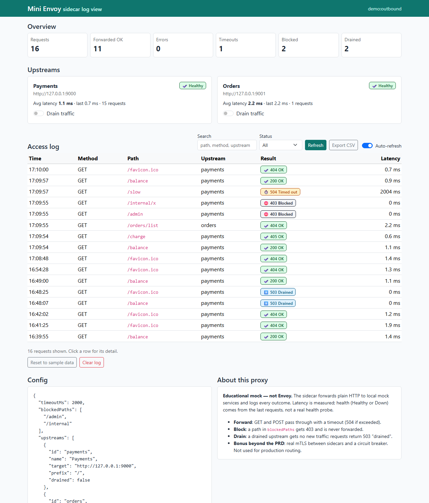
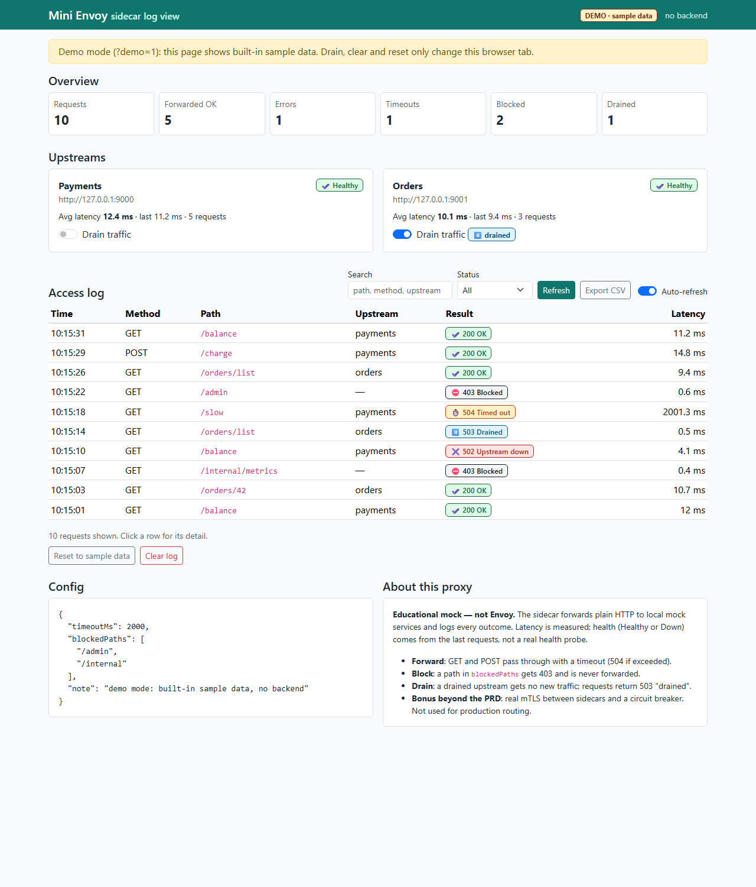
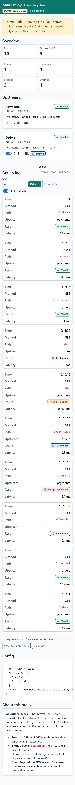

# Mini Envoy — Service Mesh Sidecar Proxy 

> **Limits, stated plainly:** this is an educational prototype, **not Envoy**. The core sidecar forwards plain HTTP to local mock
> services and logs every outcome. Health (Healthy/Down) comes from recent request results, not a real health probe, and drain is a
> manual per-upstream switch. Real mTLS between sidecars and a circuit breaker are included as a **bonus beyond the PRD**;
> there is no service discovery, load balancing or production routing.

```
curl / app --http--> [sidecar :8001] --http--> Payments mock :9000   (prefix /)
                          |           \--http--> Orders mock   :9001   (prefix /orders)
                          +-- HTML log view /__sidecar/logs   +-- admin API for the phone app
```

## What it does
| Feature | How |
|---|---|
| Forward GET/POST to a mock upstream, response returned unchanged | `Sidecar.handle` |
| Access log: method, path, status, latency, upstream (JSONL file, survives restart) | `<name>-access.jsonl` |
| Request timeout, clear 504 message, logged as timed out | `timeoutMs` in `config.json` |
| HTML log view (Bootstrap 5, phone cards + laptop table, auto-refresh, demo mode) | `ui/index.html` at `/__sidecar/logs` |
| Block a configured path: 403, never forwarded, logged as blocked | `blockedPaths` |
| Per-upstream traffic drain: 503 "drained", resumes when switched off, saved to the config file | `POST /__sidecar/drain` |
| Search and status filters, CSV export, row detail, config and About views, empty and error states | log view |
| Sample data seed and reset | "Reset to sample data" button |
| Phone app: Health + Traffic Toggle (Expo Go), loading/error/empty states, pull-to-refresh | `mobile/mini-envoy-app/` |
| *Bonus:* mTLS 1.3 between sidecars, caller allowlist, wiretap proof, circuit breaker | `--cert/--key/--ca`, `test_mesh.py` |

Request decision order: allowlist (mTLS only) -> blocked path -> drained upstream -> breaker -> forward with timeout.

## Run (no certs needed)
```bash
pip install aiohttp
python payments_app.py 9000 &          # Payments mock
python payments_app.py 9001 &          # Orders mock
python sidecar.py --name demo --outbound-port 8001 --config config.json --admin-token secret
curl localhost:8001/balance            # forwarded
curl localhost:8001/admin              # 403 blocked
curl localhost:8001/slow               # 504 after timeoutMs
# open http://localhost:8001/__sidecar/logs in a browser
```
Drain from the terminal:
`curl -XPOST localhost:8001/__sidecar/drain -H 'authorization: Bearer secret' -d '{"upstream":"payments","drained":true}'`

## Phone app (Expo Go)
The app lives in `mobile/mini-envoy-app/`. Two screens: **Health** (latency and Healthy/Down per upstream, refreshing every 3 s) and **Traffic toggle** (a drain switch per upstream, with a confirmation).

```bash
cd mobile/mini-envoy-app
npm install
npx expo start            # scan the QR with Expo Go, or enter exp://<laptop-ip>:8081 manually
```
1. Start the sidecar with `--admin-host 0.0.0.0 --admin-token secret` so the phone can reach it.
2. Put the phone and laptop on the same network. Campus Wi-Fi often blocks device-to-device traffic: connect the laptop to the **phone's hotspot** instead.
3. On Windows, allow Python through the firewall (Private networks) when prompted.
4. Find the laptop IP with `ipconfig` (Windows) or `ip addr` (Linux), check `http://<laptop-ip>:8001/__sidecar/health` opens in the phone's browser, then type `http://<laptop-ip>:8001` and token `secret` into the app.

**Check it works:** drain Payments in the app, then `curl localhost:8001/balance` returns `503 drained` and the log page shows a Drained row. Resume and it returns 200 again.

The app handles the states the PRD asks for: no address yet, connecting (spinner), connected, can't connect (with Try again), and no upstreams. Pull down to refresh. Tap targets are at least 48 px.
## Tests
```bash
python test_prd.py     # 29 checks: forward, log, timeout, block, drain, health, CSV, UI, token
python test_mesh.py    # 16 bonus checks: mTLS, rogue CA rejected, no plaintext on the wire, circuit breaker
```
`test_mesh.py` needs `bash certs/gen_certs.sh` first. Never commit `certs/*.pem`.

## Demo mode and GitHub Pages
The log view has a **demo mode**: when it can't reach the sidecar, or the URL has `?demo=1`, it shows built-in sample data with a clear "DEMO · sample data" badge. Drain, clear and reset then only change that browser tab. This lets the log view run on GitHub Pages without a backend.

- Live demo (sample data): https://apexxx01.github.io/service-mesh-sidecar-proxy/
- With a real sidecar: `http://localhost:8001/__sidecar/logs` (or the static page with `?api=http://<host>:8001/__sidecar`)

The workflow in `.github/workflows/pages.yml` publishes `ui/` on every push to `main`. One-time setup by the repo owner: **Settings → Pages → Source: GitHub Actions**.

## Screenshots
| Laptop | Phone |
|---|---|
|  |  |
|  |  |

## Wireframes
Low-fidelity wireframes for all 7 PRD screens (Overview, Access Log, Log Detail, Config, About, Mobile Health, Mobile Traffic Toggle) are in [`docs/wireframes/`](docs/wireframes/), each mapped to its user stories.

## Team
| Name | Role |
|---|---|
| Shridhar Raikar | Backend: sidecar proxy, forwarding, timeout, blocking, drain API, health, tests |
| J Nishanth Reddy | Front end: Expo phone app, wireframes, log view demo mode and accessibility, screenshots, usability notes |

Mentor: Madhushri Tangali